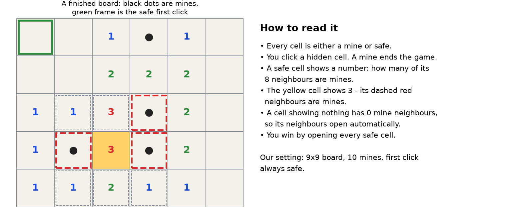
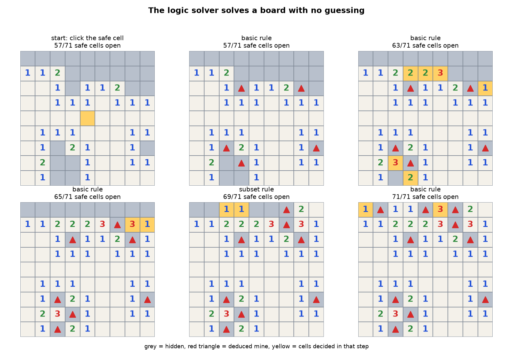
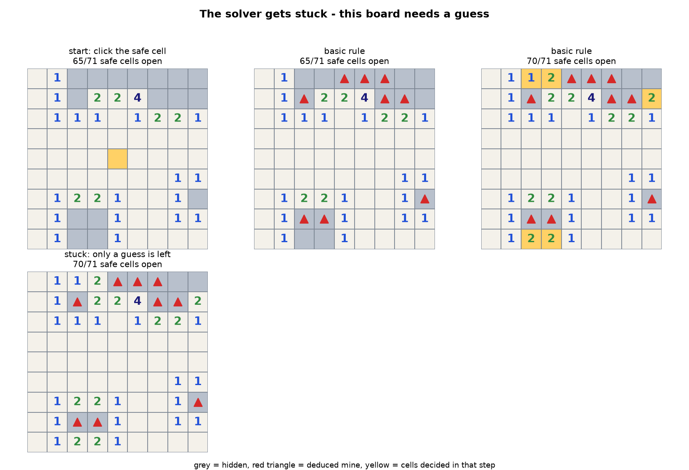
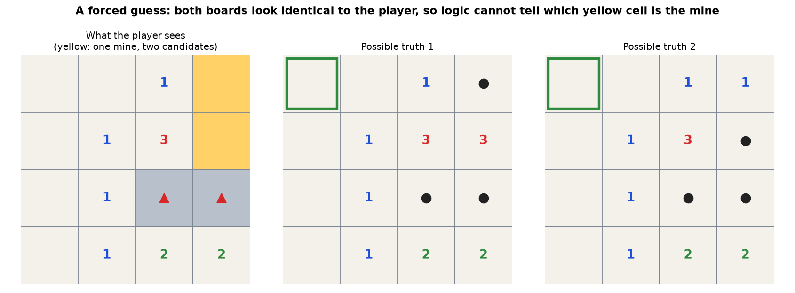
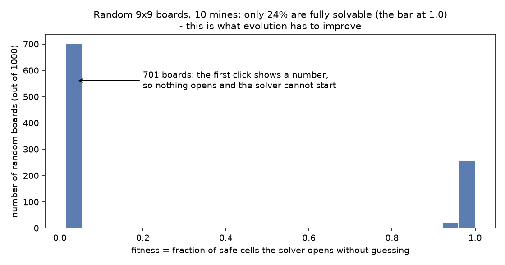

# Minesweeper in 5 minutes

A short visual introduction for readers who do not know Minesweeper. All pictures are generated from the project's own code by `uv run examples/minesweeper/generate_docs_images.py`.

## 1. The game

A board is a grid. Some hidden cells contain **mines**, the rest are **safe**. You click a hidden cell:

- a mine ends the game,
- a safe cell shows a **number** - how many of its (up to 8) neighbours are mines,
- a cell showing no number has 0 mine neighbours, so all its neighbours open automatically (a "flood fill"),
- you win when every safe cell is open.

In this project we use a **9x9 board with 10 mines**, and the first click is always safe.

## 2. Solving by logic, without guessing

A player can often work out where the mines are using only the numbers. Our **logic solver** does exactly this and never guesses. It uses two rules:

1. **Basic rule.** If a number equals the count of its hidden neighbours, they are all mines (red triangles). If a number already has all its mines marked, its remaining hidden neighbours are all safe.
2. **Subset rule.** If the hidden neighbours of one number are a subset of another number's, compare the two: the extra cells hold exactly the difference of the numbers. In the picture, the "subset rule" step opens cells that the basic rule alone could not.

The solver repeats the rules until the board is finished or no rule applies.

## 3. When logic is not enough

Some boards cannot be finished by logic: the solver stops with safe cells still hidden, because every remaining move is a **guess**.

The smallest example is a **50/50**: two different boards look exactly the same to the player (the visible numbers match), and one of the two yellow cells is a mine. No reasoning can tell which. Players find these frustrating and unfair.

## 4. The project's goal

Use **evolutionary algorithms** to generate boards that the logic solver can finish completely, so no guessing is ever needed. The score of a board (its *fitness*) is the fraction of safe cells the solver opens without guessing; 1.0 means the board is fully solvable.

## 5. How good are random boards?

This is the baseline evolution has to beat. Out of 1000 random 9x9 boards, only about 24% are fully solvable (right bar). Most of the rest are at fitness ~0: the first click shows a number instead of a zero, so nothing opens and the solver cannot even start. That is a property of the current rules (only the start cell is guaranteed mine-free), and it makes the baseline look worse than it would under the classic rule that the start cell and all its neighbours are mine-free.

## Glossary

| Term | Meaning |
|---|---|
| Mine / safe cell | A cell that explodes when clicked / one that does not |
| Number | How many of the 8 neighbours are mines |
| Flag (red triangle) | A cell the solver has deduced to be a mine |
| Solvable board | The logic solver opens every safe cell without guessing |
| Fitness | Fraction of safe cells opened without guessing (1.0 = solvable) |
| Method A | Evolve the board itself (list of mine positions) |
| Method B | Evolve a neural network that produces boards |
